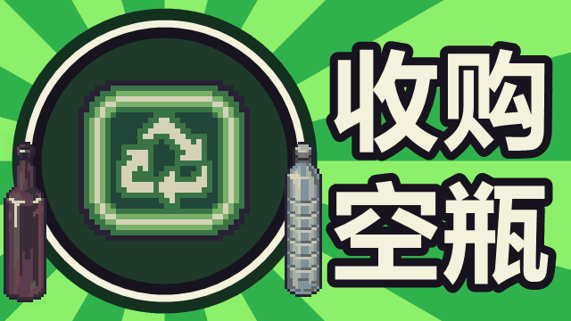
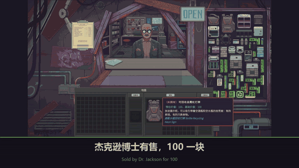
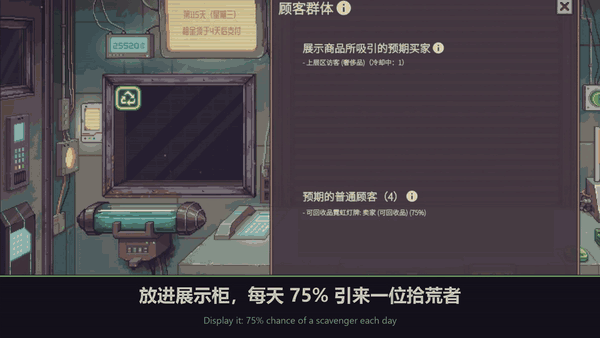
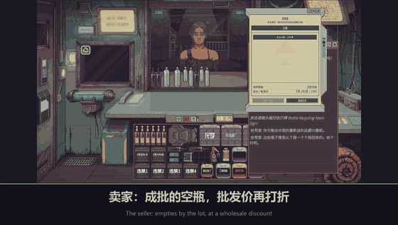
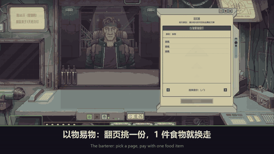
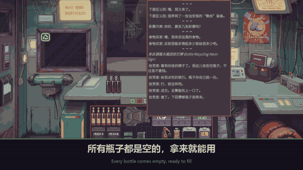

# 酒瓶水瓶回收灯牌 · Recyclable Bottle Neon Sign

《深空当铺：可能是偷的》(Probably Stolen) 的模组。[English below](#english)



新增一块绿色的 2×2 广告灯牌。把它放进展示柜，拾荒者就会带着空酒瓶和空水瓶上门，酿酒和卖水不用再到处凑瓶子。

## 下载

- **[下载最新版 RecyclableSign.zip](https://github.com/Matsulen/ProbablyStolen-RecyclableBottleSign/releases/latest/download/RecyclableSign.zip)**
- [全部版本](https://github.com/Matsulen/ProbablyStolen-RecyclableBottleSign/releases)
- [Steam创意工坊](https://steamcommunity.com/sharedfiles/filedetails/?id=3838867680)

## 安装

1. 下载 `RecyclableSign.zip` 并解压，得到 `RecyclableSign` 文件夹。
2. 把这个文件夹放进游戏目录的 `Mods` 文件夹，例如 `Steam\steamapps\common\Probably Stolen\Mods\RecyclableSign`。没有 `Mods` 文件夹就新建一个。
3. 启动游戏，在主菜单的模组菜单里选中本模组并启用，然后重启游戏。

适用游戏版本：0.46。可以加入已有存档。

## 功能

### 获取

没有这块灯牌时，杰克逊博士会出售，单价 100。它和原版灯牌一样可以放进档案箱。



### 效果

灯牌在展示柜里时，每天有 75% 的概率吸引来一位拾荒者，并显示在客流面板里。他排在所有展示柜顾客的最前面。来的人是下面两种之一，各占一半。



### 卖家

- 按批发价打 15%～25% 的折扣出售。
- 保底 2 个空酒瓶和 2 个水瓶，另有若干件随机追加，通常 5～8 件。
- 下层声望越高，越容易带来大瓶和额外的酒瓶；声望超过 50 时必定带一个水罐。
- 货物按酒瓶、水罐、大瓶、标准瓶、小瓶的顺序摆上柜台。



### 以物易物

- 不要钱，只要吃的：任意 1 件食物换一整页的瓶子。
- 和原版以物易物一样可以翻页挑选，成交一次后离开。
- 第 1 页：空酒瓶 ×3
- 第 2 页：小瓶 ×2 和标准瓶 ×2
- 第 3 页：大瓶 ×2
- 第 4 页：水罐 ×1（声望越高越常见，超过 50 时必定有）



所有瓶子都是空的。



> 动图录制于较早的版本，界面上的模组英文名和柜台摆放顺序与当前版本略有不同。

## 兼容性

- 使用游戏原生模组接口，不需要任何前置模组。
- 不申请任何权限：不联网，只读取本模组自己的文件。
- 兼容“更好的收银台 Better Cashier”：灯牌在它的收银台界面里正常显示贴图。
- 中途移除本模组后，存档里的灯牌会变成“未知物品”，重新启用即恢复。
- 支持简体中文和英文，其他语言显示英文。

## 从源码构建

需要 .NET SDK 和已安装的游戏本体（编译时引用游戏自带的程序集）。

```
dotnet build -c Release -p:GameDir="你的游戏目录"
```

构建结果在 `dist\RecyclableSign`。加上 `-p:Install=true` 会同时复制到游戏的 `Mods` 文件夹。

### 目录结构

| 路径 | 内容 |
|---|---|
| `src/` | C# 源码：模组入口、拾荒者顾客、Harmony 补丁 |
| `manifest.xml` | 模组清单 |
| `Textures/Items/` | 灯牌贴图 |
| `Localization/` | 中英文文本 |
| `art/` | 贴图的 Aseprite 源文件和生成脚本 |
| `workshop/` | 封面图、动图、创意工坊文案 |

## 许可证

代码和灯牌贴图以 [MIT 许可证](LICENSE) 发布。

封面图和动图中出现的游戏画面、角色与界面，版权归《深空当铺：可能是偷的》的开发者 Questing Goose Studio 所有，不在本许可证范围内。本模组为爱好者作品，与官方无关。

---

<a name="english"></a>

## English

A mod for *Probably Stolen*.

Adds a green 2x2 neon sign. Put it in your display case and scavengers start turning up with empty wine bottles and empty water bottles, so winemaking and water selling no longer stall for lack of containers.

### Download

- **[Download the latest RecyclableSign.zip](https://github.com/Matsulen/ProbablyStolen-RecyclableBottleSign/releases/latest/download/RecyclableSign.zip)**
- [All releases](https://github.com/Matsulen/ProbablyStolen-RecyclableBottleSign/releases)
- [Steam WorkShop](https://steamcommunity.com/sharedfiles/filedetails/?id=3838867680)

### Install

1. Download `RecyclableSign.zip` and extract it. You get a `RecyclableSign` folder.
2. Move that folder into the game's `Mods` folder, for example `Steam\steamapps\common\Probably Stolen\Mods\RecyclableSign`. Create `Mods` if it does not exist.
3. Start the game, enable the mod in the Mods menu on the main menu, then restart the game.

Game version: 0.46. Safe to add to an existing save.

### What it does

- **Getting it:** Dr. Jackson sells the sign for 100 whenever you do not own one. It fits in the file box, like the vanilla signs.
- **Effect:** while the sign sits in the display case, there is a 75% chance each day that it attracts one scavenger, who queues ahead of the other display-case customers. The visitor is one of the two below, half the time each.
- **Seller:** sells wholesale at 15% to 25% off. Always brings 2 empty wine bottles and 2 water bottles plus a few random extras, usually 5 to 8 items. Higher Lower Level reputation means more large bottles and extra wine bottles; above 50 they always bring a water jug.
- **Barterer:** wants food, not credits. Any 1 food item buys a whole page of bottles: 3 wine bottles, or 2 small and 2 standard bottles, or 2 large bottles, plus a page with 1 water jug that is sometimes there, and always there once reputation is above 50. Flip through the pages as with vanilla barter. The visitor leaves after one trade.

Every container comes empty.

### Compatibility

- Built on the game's native mod API. No prerequisites.
- Declares no capabilities: no network access, and it only reads its own mod files.
- Works with Better Cashier: the sign shows its texture in that mod's cashier panel.
- If you remove the mod, signs already in the save turn into an "unknown item" and come back when you enable it again.
- Simplified Chinese and English. Other languages fall back to English.

### Build from source

You need the .NET SDK and an installed copy of the game, because the build references the game's own assemblies.

```
dotnet build -c Release -p:GameDir="path to the game folder"
```

The output is in `dist\RecyclableSign`. Add `-p:Install=true` to also copy it into the game's `Mods` folder.

### License

Code and the sign texture are released under the [MIT License](LICENSE).

Game footage, characters and interface shown in the cover and GIFs belong to Questing Goose Studio, the developer of *Probably Stolen*, and are not covered by this license. This is a fan-made mod and is not affiliated with the developer.
